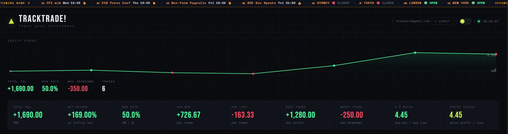
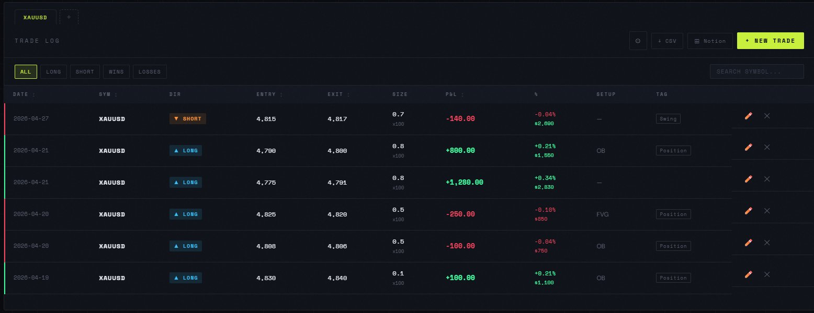
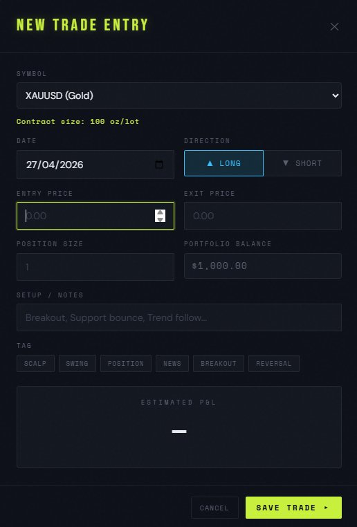

# TrackTrade

A trading journal that runs in the browser. It uses plain HTML, CSS and JavaScript, with Supabase for login and storage. The interface is Thai by default and switches to English.

<!--  -->

## Features

### Dashboard

- Four stat cards: total P&L, win rate, profit factor and best trade.
- Equity curve drawn on a canvas, with ranges for all time, this month, this week and the last 30 days.
- Calendar heatmap of daily P&L, one month at a time.
- Win and loss breakdown with gross profit and gross loss.
- Symbol performance, current streak and best streak.

### Trade log

- Add, edit and delete trades in a modal form.
- P&L preview while you type the entry and exit prices.
- Percent return and running balance on every row.
- Filter by direction or result, search by symbol, tag or note, and sort by any column.
- 50 rows per page. On phones each trade shows as a card.
- Import and export CSV. Copy the table for Notion.

### Portfolios

- Create several portfolios. Each has its own name, starting balance and trades.
- Switch portfolios from the tabs in the Trading accounts card.

### Ticker

- Market sessions in Thailand time (GMT+7). A session is green while it is open.
- Upcoming high and medium impact news from Finnhub.
- Scroll speed and highlight color are adjustable.

| Session | Time |
|---------|------|
| London | 14:00 to 17:00 |
| NY AM | 20:30 to 23:00 |
| NY Lunch Hour | 23:00 to 01:00 |
| NY PM | 01:00 to 04:00 |
| Asia | 08:00 to 12:00 |

Edit the times in `MARKET_SESSIONS` at the top of `js/ticker.js`.

### 3D intro

- Plays on the first visit. Replay it with `?intro=1`.
- 16 scroll-driven WebGL scenes in six chapters, with a skip button and an `Esc` shortcut.
- Skipped when the browser asks for reduced motion or data saving.
- `?q=0` to `?q=3` fixes the render quality. `?debug=1` exposes `window.__TT`.

### Interface

- Dark and light themes, remembered between visits.
- Thai and English, remembered between visits.
- Shortcuts: `Ctrl+N` for a new trade, `Ctrl+K` for search, `Esc` to close a dialog.
- Below 768px wide, the left rail becomes a bottom tab bar with a + button for new trades, and dialogs open as bottom sheets.

## Tech stack

| Layer | Technology |
|-------|-----------|
| Frontend | HTML, CSS and JavaScript (ES6+), no framework or bundler |
| Database and auth | [Supabase](https://supabase.com) (PostgreSQL, email and password login) |
| Charts | Canvas API |
| Intro | three.js (WebGL) |
| News | Finnhub economic calendar |
| Hosting | GitHub Pages |

## Setup

1. Create a Supabase project with `portfolios` and `trades` tables. The columns are in `js/db.js`.
2. Turn on row level security for both tables, so each user reads only the rows with their own `user_id`.
3. Put your Supabase URL and public key in `js/config.js`.
4. Put your Finnhub key in `js/config.js`. Every visitor can read it, so use a key you can rotate.
5. Serve the folder with any static server, for example `python3 -m http.server`.

## Project structure

```
index.html          App shell and modal markup
style.css           All styles, including the dark and light themes
js/config.js        Supabase setup, global state and P&L helpers
js/db.js            Create, read, update and delete for portfolios and trades
js/auth.js          Login, registration, logout and email cooldown
js/portfolio.js     Portfolio tabs, settings and the welcome dialog
js/ticker.js        Market sessions and news ticker
js/modal.js         Trade form, CSV import and export, Notion copy
js/ui.js            Rendering for the equity curve, stats, table, heatmap and mobile tab bar
js/i18n.js          Thai and English strings
js/scrolly3d.js     3D intro
docs/               Screenshots
```

## Screenshots

| Dashboard | Trade log | Add trade |
|-----------|-----------|-----------|
|  |  |  |

## Roadmap

- [ ] Day view when you click a date in the heatmap
- [ ] Equity curve for each symbol
- [ ] Tag management
- [ ] Live forex prices over WebSocket

## Author

Rapeepat Nitakorn (Fifa), student at KMITL. [GitHub](https://github.com/77Henvi)
